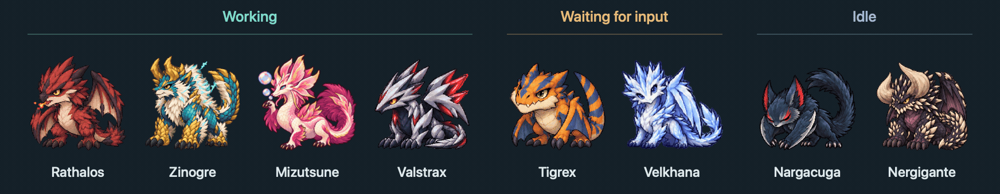

<p align="center">
  
</p>

# MH Desk Pets

Monster Hunter desktop companions for Claude Code and Codex on macOS, built with Swift and AppKit.
Each pet follows a CLI session and animates when it is working, waiting for input, or idle.



Selected companions, shown at a 1.2-second loop. Every monster has all three animations.
Browse the [full monster roster](docs/monsters.md) for previews and names in English, Traditional Chinese, and Japanese.

- English, Traditional Chinese, and Japanese UI and monster names
- Adjustable animation speed and size (64–256 px), saved automatically
- Drag pets anywhere; double-click to focus their terminal, including tmux panes and cmux tabs
- Optional translucent habitat with automatic rooms, drag-to-swap, and a handle to move pets together
- Import custom GIF characters or add monsters from PNG frames

## Build and install

Requires an Apple Silicon Mac, macOS 14+, Swift 6 (Command Line Tools), and FFmpeg.

```sh
git clone https://github.com/chesterXalan/mh-desk-pet.git
cd mh-desk-pet
brew install ffmpeg
make app
```

Copy `build/DeskPets.app` to `/Applications` and open it.
`make run` builds and opens the app; `make test` runs the tests.

## Use

1. Open **Manage… → Hooks** from the menu bar, install the hooks, and restart your CLI sessions.
2. Sessions get pets automatically. Each directory remembers your last character choice; additional sessions
   get random characters, avoiding duplicates when possible. Change a pet in **Sessions** or its context menu.
3. Right-click a pet → **Settings…** to choose a language, size, or animation duration.

The language follows the primary macOS language by default, falling back to English when unsupported.
You can also select English / 繁體中文 / 日本語 manually.
Animation duration applies to a complete loop: four frames at 1.2 seconds means 0.3 seconds per frame.
Settings apply immediately. Turn off the duration override to use each GIF's original timing.
Size is the base display size; per-character scale adjustments keep monsters visually balanced.
Ended sessions disappear automatically; directory preferences remain for the next launch.
Each directory remembers every pet's position. New sessions reuse vacant positions without moving active pets;
pets outside the available screens move back to the nearest visible area.
Selecting **None** hides a pet for that session without forgetting the directory's character choice.

Enable **Habitat** in the manager to group pets into rooms. New pets fill vacant rooms automatically;
turn off automatic placement to move them in yourself. Drag a pet into an empty room, onto another pet
to swap positions, or outside to move out. A pet moved out stays outside until you move it back or select
**Fill vacant rooms**. Drag the header handle to move the whole habitat.
Room backgrounds can be hidden; the handle stays visible, and rooms reappear while dragging a pet.
Room assignments and the habitat position survive restarts. Turning the habitat off restores free-placement
positions. Choose a **columns × rows** layout (for example, 4 × 2 gives eight rooms).
Optional **Smart resizing** treats that as the minimum size: full rooms expand toward available screen
space, favoring a compact layout while keeping existing rooms in place. Drag a pet onto a dashed room
outside an edge and release to add a row or column; passing through the preview does not expand it.
Drag farther away to move out. Moving the last resident of an added edge farther out also moves it out,
rather than leaving empty rows or columns behind. Empty added outer rows and columns shrink automatically; interior gaps
and the base area remain. Turning smart resizing off freezes the current dimensions, and manually changing
the base size resets the expansion. Expansion stops at 8 × 8 or when no side fits the screen; overflow pets
stay outside. The habitat scales down on smaller screens, and an unplugged display returns the whole group
to a visible screen.

Double-click a pet or choose **Show Terminal** to focus its session. For native Ghostty tabs, Ghostty 1.3+
and macOS Automation permission are required. DeskPets matches the session's working directory, then its
title if several terminals share that directory. If both are ambiguous, select the tab manually.
See [Ghostty's AppleScript API](https://ghostty.org/docs/features/applescript).
For tmux inside Ghostty, DeskPets identifies the client's Ghostty tab before switching panes, then focuses
that tab. It uses the client's working directory and existing tmux terminal title; tmux settings are unchanged.

## Add characters

Use **Characters → Add Character…** to choose an idle GIF, with optional working and waiting animations.
Source filenames are unrestricted; the app copies and names the files automatically in the character's folder.
To add a built-in monster, see [Character assets](docs/characters.md).
PNG frames and character metadata are versioned; GIFs are generated during the build.
The app icon source and GitHub preview are versioned too; see [Branding](docs/branding.md).

## Local data

Settings, bindings, and imported characters live in `~/Library/Application Support/DeskPets/`.
Hook installation updates `~/.claude/settings.json` and `~/.codex/hooks.json`, preserving existing hooks
and backing up each file before changes. The app does not make network requests.

## Credits

Based on [youngOman/desk-pets](https://github.com/youngOman/desk-pets), inspired by Evan's agent-pets.
Code retains the upstream [MIT license](LICENSE).
Monster Hunter characters belong to CAPCOM; the included artwork is AI-generated fan art.
