# Monster roster

32 companions, each with **idle**, **working**, and **waiting for input** animations.
Every animation uses four transparent 256 × 256 frames. Playback speed and display size are adjustable in the app.

Choose any monster in **Sessions**, or right-click a pet to change its character.
Thumbnails below link to the source frames; this roster is generated from the character metadata.
Monsters follow the same numeric **EM ID** order as the app. These are game resource IDs,
not encyclopedia numbers or popularity ranks; see [numbering sources](characters.md#monster-numbering).

| EM ID | Preview | English | 繁體中文 | 日本語 |
| --- | --- | --- | --- | --- |
| `em002` |  | Rathalos | 火龍 | リオレウス |
| `em011` | <a href="../Resources/Characters/kirin">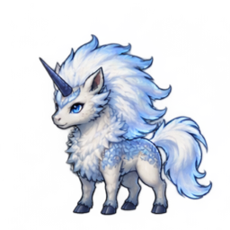</a> | Kirin | 麒麟 | キリン |
| `em013` | <a href="../Resources/Characters/fatalis">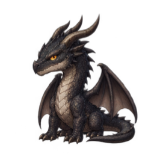</a> | Fatalis | 黑龍 | ミラボレアス |
| `em023` | <a href="../Resources/Characters/rajang">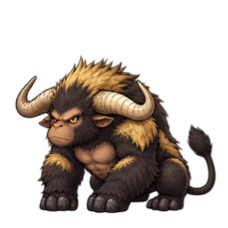</a> | Rajang | 金獅子 | ラージャン |
| `em024` | <a href="../Resources/Characters/kushala-daora">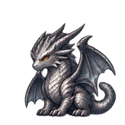</a> | Kushala Daora | 鋼龍 | クシャルダオラ |
| `em025` | <a href="../Resources/Characters/chameleos">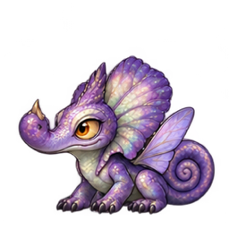</a> | Chameleos | 霞龍 | オオナズチ |
| `em026` | <a href="../Resources/Characters/lunastra">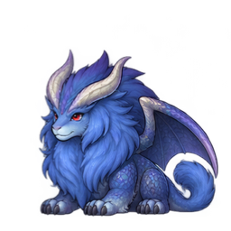</a> | Lunastra | 炎妃龍 | ナナ・テスカトリ |
| `em027` | <a href="../Resources/Characters/teostra">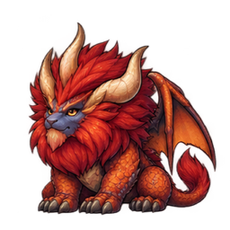</a> | Teostra | 炎王龍 | テオ・テスカトル |
| `em032` |  | Tigrex | 轟龍 | ティガレックス |
| `em037` |  | Nargacuga | 迅龍 | ナルガクルガ |
| `em043` | <a href="../Resources/Characters/deviljho">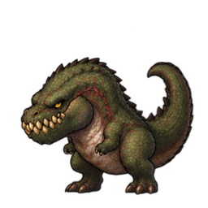</a> | Deviljho | 恐暴龍 | イビルジョー |
| `em046` | <a href="../Resources/Characters/lagiacrus">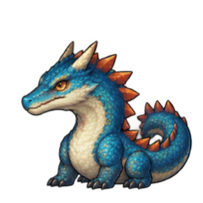</a> | Lagiacrus | 海龍 | ラギアクルス |
| `em050` | <a href="../Resources/Characters/alatreon">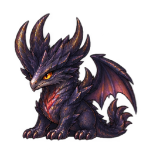</a> | Alatreon | 煌黑龍 | アルバトリオン |
| `em057` |  | Zinogre | 雷狼龍 | ジンオウガ |
| `em058` | <a href="../Resources/Characters/amatsu">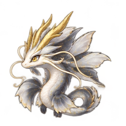</a> | Amatsu | 嵐龍 | アマツマガツチ |
| `em063` | <a href="../Resources/Characters/brachydios">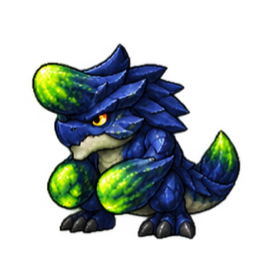</a> | Brachydios | 碎龍 | ブラキディオス |
| `em071` | <a href="../Resources/Characters/gore-magala">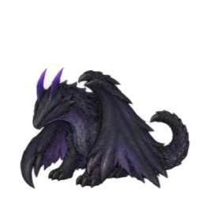</a> | Gore Magala | 黑蝕龍 | ゴア・マガラ |
| `em072` | <a href="../Resources/Characters/shagaru-magala">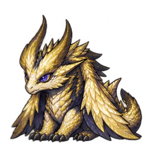</a> | Shagaru Magala | 天迴龍 | シャガルマガラ |
| `em077` | <a href="../Resources/Characters/seregios">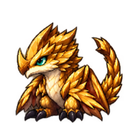</a> | Seregios | 千刃龍 | セルレギオス |
| `em080` | <a href="../Resources/Characters/glavenus">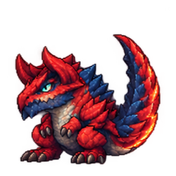</a> | Glavenus | 斬龍 | ディノバルド |
| `em081` | <a href="../Resources/Characters/astalos">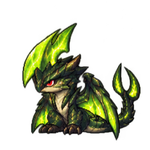</a> | Astalos | 電龍 | ライゼクス |
| `em082` |  | Mizutsune | 泡狐龍 | タマミツネ |
| `em083` | <a href="../Resources/Characters/gammoth">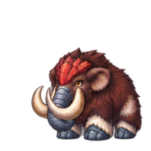</a> | Gammoth | 巨獸 | ガムート |
| `em086` |  | Valstrax | 天彗龍 | バルファルク |
| `em089` | <a href="../Resources/Characters/magnamalo">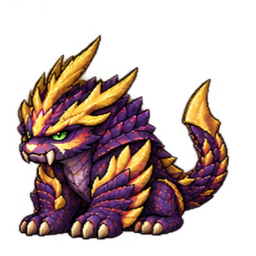</a> | Magnamalo | 怨虎龍 | マガイマガド |
| `em103` |  | Nergigante | 滅盡龍 | ネルギガンテ |
| `em113` | <a href="../Resources/Characters/odogaron">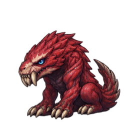</a> | Odogaron | 慘爪龍 | オドガロン |
| `em118` | <a href="../Resources/Characters/bazelgeuse">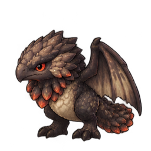</a> | Bazelgeuse | 爆鱗龍 | バゼルギウス |
| `em124` |  | Velkhana | 冰呪龍 | イヴェルカーナ |
| `em125` | <a href="../Resources/Characters/namielle">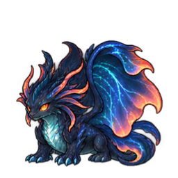</a> | Namielle | 溟波龍 | ネロミェール |
| `em132` | <a href="../Resources/Characters/malzeno">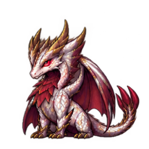</a> | Malzeno | 爵銀龍 | メル・ゼナ |
| `em160` | <a href="../Resources/Characters/arkveld">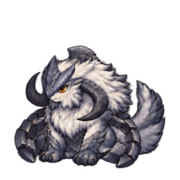</a> | Arkveld | 鎖刃龍 | アルシュベルド |

To add a companion, see [Character assets](characters.md), then run `make catalog` to refresh this list.
The [README preview](../README.md) shows a selection of the roster.

Monster Hunter characters belong to CAPCOM. These sprites are AI-generated fan art.
